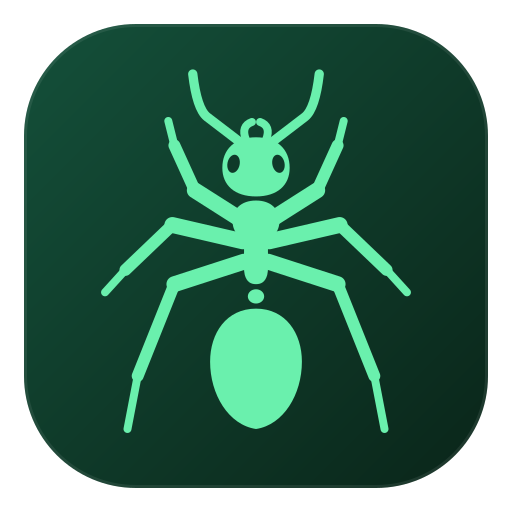

<div align="center">
  <a href="https://jonasheinle.de">
    
  </a>
</div>

# ✨ Jonas Heinle

> **Software Engineer** · **Open-Source Tinkerer** ·
> Building lightweight, reusable apps and tools — on and off stage.

---

## 🎯 About me

I'm an AI developer based in **Germany** who bridges engineering and performance.  
I build cross-platform apps, native backends, and developer tools.

| 🌐 | What I offer |
|---|---|
| **Frontend** | Flutter/Dart web + native apps (responsive, portable), React |
| **Backend** | Rust, C++, Python for inference & realtime pipelines |
| **Server** | Nginx |
| **DevOps** | CI/CD, reproducible builds, Docker, multi-platform tooling |

---

## 🛠️ Tech Stack

```
Frontend     →  Flutter · Dart · WebAssembly · React
Backend      →  Rust · C++ · Python
Multimedia   →  GStreamer · ONNX · ffmpeg
Infrastructure →  Containerd · CICD · CMake · Linux/WSL
```

---

## 📌 Featured Projects

### 🎨 **OmniAccelerANT** — Cross-platform inference app
Deploy AI on Linux, Windows, Android and the web with native UI and fast inference.
→ [github.com/Kataglyphis/OmniAccelerANT][7]

### 🚀 **BeschleunigerBallett** — C++23 / Vulkan acceleration playground
Playground for making AI/Graphics workloads fast.  
→ [github.com/Kataglyphis/BeschleunigerBallett][5]

### 🐳 **ANTfrastructure** — Build images and shared CI tooling
Multi-arch container images plus the actions, gates and scripts every repo above consumes.
→ [github.com/Kataglyphis/ANTfrastructure][8]

### 🐈 **WebDavClient** — Developer tools
Download files and folders from your WebDAV storage automatically, e.g. in CI.
→ [github.com/Kataglyphis/WebDavClient][9]

👉 **[More projects on GitHub →][2]**

How all my repositories fit together: **[the map →][10]**

---

## 🎭 & 💻 Blending Performance with Engineering

---

## 🔍 Looking For

- 🤝 Collaborations on **edge inference**, **multimedia pipelines** (GStreamer), **cross-platform UIs**
- 👥 Open-source **co-maintainers** for reusable components and tooling

---

## 📫 Connect With Me

| Platform | Link |
|----------|------|
| 🌍 **Website** | [jonasheinle.de][1] |
| 💻 **GitHub** | [github.com/Kataglyphis][2] |
| 💼 **LinkedIn** | [linkedin.com/in/jonas-heinle...][3] |
| 🔧 **Stack Overflow** | [stackoverflow.com/users/7099847][4] |
| 📸 **Instagram** | [@jotrockenmitlocken][6] |

## 🎯 Fun Facts

- 🏋️ Gym enthusiast — my reset button between sprints and debugging sessions
- 🐱 Cat person — petting cats is my favorite way to decompress

[1]: https://jonasheinle.de
[2]: https://github.com/Kataglyphis
[3]: https://de.linkedin.com/in/jonas-heinle-0b2a301a0/en
[4]: https://stackoverflow.com/users/7099847/jonas-jones-heinle
[5]: https://github.com/Kataglyphis/BeschleunigerBallett
[6]: https://www.instagram.com/jotrockenmitlocken/
[7]: https://github.com/Kataglyphis/OmniAccelerANT
[8]: https://github.com/Kataglyphis/ANTfrastructure
[9]: https://github.com/Kataglyphis/WebDavClient
[10]: https://github.com/Kataglyphis/ANTfrastructure/blob/develop/docs/repository-family.md
